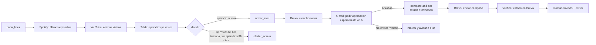

# 01 · Aviso de nuevo episodio del podcast

## El problema

Cada semana sale un episodio nuevo del podcast en Spotify y en YouTube. Flor duplicaba a mano una campaña en Brevo, cambiaba título, texto, imagen y links, y la mandaba a su lista de suscriptores (más de 600 contactos). Era una tarea repetitiva y fácil de equivocar.

## La solución

Cada hora el flujo revisa Spotify. Cuando aparece un episodio nuevo:

1. Busca el video de YouTube que le corresponde.
2. Arma el mail con el diseño de la marca: título, miniatura del video, texto y botones a Spotify y YouTube.
3. Crea la campaña en Brevo como **borrador**.
4. Le manda a Flor un correo con la vista previa y dos botones: **Aprobar** o **No enviar**.
5. Solo si aprueba, la campaña sale a toda la lista. Si no responde en 48 horas, no se manda nada y se le avisa.

## Decisiones técnicas que importan

- **Spotify manda, YouTube acompaña.** Los títulos no coinciden entre plataformas y YouTube tiene videos que no son episodios, así que el disparo es siempre Spotify. El video se empareja por **fecha (±1 día, hora Uruguay)**, con parecido de palabras como desempate. Si hay más de un candidato, el correo de aprobación lo advierte.
- **Se descartó el RSS de YouTube** después de probarlo: devolvía 404 aunque la página lo anunciara. Se usan las **APIs oficiales** (Spotify Web API con OAuth2 y YouTube Data API v3 con una key restringida solo a esa API).
- **Cero doble envío.** Antes de enviar, el flujo cambia el estado de `esperando_aprobacion` a `enviando` con una condición (*compare-and-set*) y solo sigue si cambió exactamente una fila. El envío **no tiene reintentos automáticos**: si Brevo da error, el flujo consulta el estado real de la campaña antes de decidir, para no mandarla dos veces ni avisar un falso "falló".
- **Nada queda trabado sin que nadie se entere:** aprobación sin respuesta, envío colgado, episodio sin video a las 6 horas o ningún episodio nuevo en 30 días generan una alerta, **una sola vez**.
- **Nunca avisa algo viejo.** Al activarlo, los episodios existentes se marcaron como "ya avisados". Cualquier pendiente con más de 3 días se abandona con aviso, en lugar de mandarse tarde.
- **Mail con diseño de marca** escrito en HTML para clientes de correo (tablas, estilos en línea). El texto sale de la descripción de YouTube, limpia de capítulos, hashtags y links. `vista_previa_mail.html` es la herramienta que usé para probar el diseño con 7 descripciones reales antes de publicarlo.

## Cómo se probó

- Primero con una lista de prueba en Brevo: aprobar, no enviar, aprobación vencida (con el tiempo bajado a 2 minutos) e idempotencia (correr dos veces no hace nada).
- **Robustez rompiendo a propósito:** rompí la URL de YouTube en producción, confirmé que la alerta llegara con el paso y la pista correctos, y lo restauré.
- Una auditoría adversarial del flujo encontró 3 riesgos críticos (doble envío por carrera, reintentos en el envío y cruce de videos). Los tres se corrigieron en la v2, que es la que está acá.

**Archivos:** `aviso_nuevo_episodio.js` (fuente del flujo, 24 nodos) · `vista_previa_mail.html` (banco de pruebas del diseño del mail)
