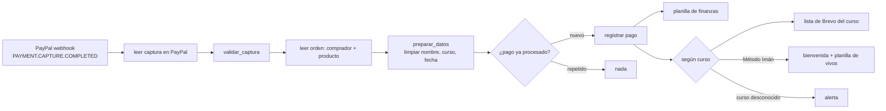

# 02 · Ventas por PayPal

## El problema

Flor ya tenía automatizadas las ventas por Stripe, pero las de PayPal se cargaban a mano: anotar el ingreso en la planilla de finanzas, sumar a la clienta a la lista de su curso en Brevo y mandarle la bienvenida.

## La solución

## Decisiones técnicas que importan

- **Antes de escribir una línea, leí los pagos reales.** Nadie sabía bien cómo cobraba Flor por PayPal, así que armé un flujo temporal de solo lectura para ver los últimos 30 días. Así encontré que la mayoría entraba por botón o link de pago (con producto) y que algunos eran transferencias entre personas sin producto, que no deben disparar nada.
- **El webhook no se cree tal cual:** con el id del aviso, el flujo vuelve a leer la captura y la orden en la API de PayPal (OAuth2 client credentials) y saca de ahí comprador, monto y producto.
- **Idempotencia:** tabla de pagos procesados. Si PayPal reenvía el mismo aviso, no se duplica la fila de finanzas ni la bienvenida.
- **Curso desconocido = alerta, no silencio.** Si el nombre del producto no coincide con ningún curso, el pago igual entra a finanzas y llega un aviso para revisarlo.
- **Reintentos** en todas las llamadas externas y error workflow conectado.
- **Modo prueba** con un disparador manual que reprocesa un pago real pero manda todo a una lista de prueba y marca las filas como PRUEBA.

**Detalle de configuración que costó encontrar:** la credencial nativa de PayPal en n8n no manda el header de autorización cuando se usa desde un nodo HTTP Request (da 401). Para leer órdenes y capturas hizo falta una credencial OAuth2 genérica con *client credentials*.

## Cómo se probó

4 escenarios con un pago real, verificados en el dato final: curso normal (lista de Brevo + fila en finanzas con medio de cobro PayPal), el mismo pago otra vez (frenado), curso con bienvenida (mail recibido + fila de vivos) y curso desconocido (alerta recibida). Después se borraron todas las filas de prueba.

**Archivo:** `paypal_courses_sales_automation.js` (21 nodos)
