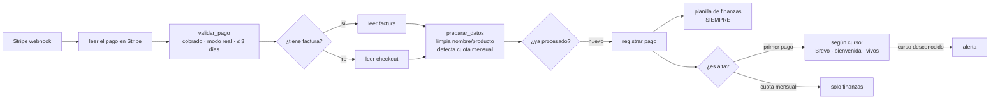

# 03 · Ventas por Stripe: auditoría de seguridad y rediseño

## El punto de partida

Este flujo ya existía y "andaba": cada pago en Stripe sumaba a la clienta a una lista de Brevo según el curso, anotaba el ingreso en la planilla de finanzas y, para un curso, mandaba la bienvenida y agregaba una fila con sus sesiones en vivo. El pedido fue hacerlo **más seguro sin romper nada** (atiende ventas reales todos los días).

## Lo que encontré revisando las ejecuciones reales

1. **Una venta perdida.** Un pago real de USD 127 por link de pago, sin cliente asociado en Stripe, hizo fallar el flujo. No quedó en finanzas ni se avisó a nadie.
2. **Bienvenidas que se iban a duplicar cada mes.** Varias clientas parecían "volver a comprar". Con un flujo temporal de solo lectura confirmé en Stripe que eran **suscripciones mensuales**: cada cobro mensual iba a reenviar la bienvenida y crear otra fila de sesiones. Todavía no había pasado (el primer pago fue antes de que existiera el flujo), pero iba a empezar el mes siguiente.
3. **El webhook creía cualquier aviso.** Un aviso falso a la URL del webhook habría disparado bienvenida (con links privados), listas y registros en finanzas.
4. **Sin protección contra duplicados** si Stripe reenvía un evento.
5. **Datos de la clienta sin limpiar:** el nombre iba crudo al HTML del mail y a Google Sheets, donde un texto que empieza con `=` se ejecuta como fórmula.
6. **Curso no reconocido = silencio**, y faltaban reintentos en algunos pasos.

## El rediseño (24 nodos)

- **Se relee el pago en la API de Stripe** con el id del evento. Si no existe, no está cobrado, es de modo test o tiene más de 3 días, el flujo se frena con alerta.
- **Pagos sin cliente:** los datos salen de la factura o, si no hay, del checkout del link de pago.
- **Regla de cuotas (aprobada por el negocio):** si la factura es `subscription_cycle`, solo se anota en finanzas, sin bienvenida ni fila de sesiones.
- **Anti-duplicado** con una tabla de pagos procesados.
- **Datos limpios:** se quitan etiquetas HTML y el `=` inicial, y los cuerpos para Brevo se arman con `JSON.stringify` en lugar de concatenar texto.
- **Alerta** si el curso no se reconoce o falta un email válido. Reintentos en todo lo externo.

## Cómo se publicó sin romper

- Respaldo de la versión activa antes de tocar nada, con el camino para volver atrás anotado.
- 6 pruebas en el borrador, con el producción viejo funcionando mientras tanto: cuota mensual, alta nueva, evento repetido, la venta perdida de USD 127 reprocesada, un producto con `=1+1 <b>...</b>` (llegó sin fórmula ni HTML) y un id inventado (frenado).
- Después de borrar los datos de prueba, verifiqué que las filas reales de finanzas y de sesiones quedaran idénticas.
- Al publicar, confirmé en Stripe que el webhook original **seguía activo y con la misma URL** (no se recreó ni se cortó).

**Archivo:** `stripe_courses_sales_automation.json` (exportación de n8n, importable)
