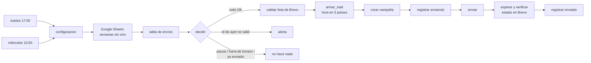

# 04 · Recordatorios del vivo semanal por mail

## El problema

Las alumnas del programa Masterpiece tienen un vivo por Zoom todos los miércoles a las 11:00 (hora Uruguay). Hay que recordarles por mail el día anterior y una hora antes, todas las semanas, salvo las semanas en que no hay vivo.

## La solución

## Decisiones técnicas que importan

- **Las pausas las maneja una persona no técnica.** La asistente de Flor carga en una planilla de Google la fecha del miércoles sin vivo. La hoja tiene validación de fecha y una pestaña con instrucciones. El flujo **no adivina**: si una fecha no se entiende, o si cae en la semana del vivo pero no es miércoles (probable error de carga), no manda nada y avisa.
- **Guardas de horario:** si el disparo llega fuera de su ventana (por ejemplo, porque el servidor estuvo caído), no se manda tarde.
- **Hora correcta en 5 lugares** (Uruguay/Argentina, Chile, Colombia, México y España) calculada con Luxon para la fecha de cada vivo, así los cambios de horario de verano no rompen nada.
- **Sin doble envío:** cada mail tiene una clave `fecha|tipo` en una tabla; si ya figura como enviado o enviando, no sale otra vez.
- **Verificación real:** después del envío, el flujo espera y vuelve a consultar la campaña en Brevo para confirmar que quedó enviada.
- **Control cruzado:** el mail de "1 hora antes" revisa que el del día anterior haya salido. Si no, avisa (y el de hoy sale igual).
- **Validación de la lista:** si la lista de Brevo quedó vacía o sin contactos activos, no se crea la campaña.
- **Modo prueba con un solo interruptor** (`modo_prueba`): mismo flujo, otra lista, claves marcadas como PRUEBA.

## Un hallazgo de n8n que vale la pena contar

Las alertas llegaban cortadas. Investigando descubrí que, cuando un nodo Code lanza un error, n8n parte el mensaje en cada `:` y conserva solo los dos últimos pedazos. Un error como `Se disparó a las 19:36: fuera de horario` llegaba como `36, fuera de horario`. Lo resolví en dos lados: el flujo de alertas reconstruye el mensaje completo, y cada nodo Code usa un pequeño `falla()` que reemplaza los `:` antes de lanzar el error.

## Cómo se probó

Envíos reales a una lista de prueba (recibidos y revisados en la bandeja), cada guarda probada por separado (fuera de horario, no es miércoles, semana pausada, fecha mal cargada, una fecha que no la afecta) y limpieza de la lista y las filas de prueba antes de activar.

**Archivo:** `mail_masterpiece_recordatorios.js` (23 nodos)
