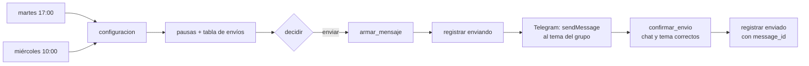

# 05 · Recordatorios del vivo semanal por Telegram

## El problema

Además del mail, las alumnas reciben el link de Zoom en su grupo de Telegram, dentro de un tema ("sección") específico del grupo. La idea era que nadie tuviera que acordarse de publicarlo a mano dos veces por semana.

## La solución

Mismo esqueleto que el [flujo de mails](../04-recordatorios-vivo-mail): mismos horarios, **la misma planilla de pausas** y las mismas guardas. Cambia solo el final, que en lugar de crear una campaña de Brevo publica un mensaje con el bot.

## Decisiones técnicas que importan

- **Flujo separado, no un paso más del de mails.** Si un canal falla, el otro sale igual, y no hubo que tocar el flujo de mails antes de su primer envío real. Cada canal tiene su propia clave de "ya enviado" (`fecha|tipo|telegram`).
- **Grupos con temas:** un bot no se puede sumar a un tema, sino al grupo. El mensaje lleva `message_thread_id`, y después del envío el flujo **comprueba que la respuesta de Telegram tenga ese mismo chat y ese mismo tema**. Si cayó en otro lado, lo marca como error y avisa.
- **El chat id y el tema salen de la configuración**, nunca de otro lado. En modo real, si falta el tema, el flujo no manda (si no, el mensaje caería en el tema general a la vista de todos).
- **Para sacar el chat id** armé un flujo temporal que solo escucha al bot. Se publicó antes de sumar el bot al grupo real, así el evento "bot agregado" llegó solo y nadie tuvo que escribir en el grupo. Después se despublicó y archivó.
- **Texto en HTML escapado** y sin la firma de "enviado con n8n" que el nodo agrega por defecto.

## Cómo se probó

- Envíos reales a un grupo de prueba, revisados en Telegram (nombre del bot, foto, vista previa del link).
- **Prueba en el grupo real sin molestar:** un mensaje sin notificación en el tema correcto, confirmación del `message_thread_id` en la respuesta y borrado automático a los ~2 segundos. Así se comprobó que el bot podía escribir ahí sin ser administrador.
- Guardas en modo real (no es miércoles, fuera de horario) y limpieza de las filas de prueba antes de activar.

**Archivo:** `telegram_masterpiece_recordatorios.js` (16 nodos)
