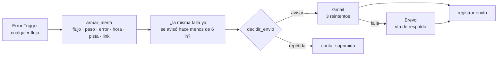

# 06 · Alertas de errores (un flujo que vigila a todos)

## El punto de partida

Existía un flujo de errores que mandaba un correo que decía solo "Hubo un error": sin decir qué flujo, qué paso ni qué pasó. Además salía por la misma cuenta de Gmail que usan los demás flujos, así que si esa credencial se caía, la alerta también.

## El rediseño

- **La alerta dice qué hacer:** flujo, paso, error, hora de Uruguay, link directo a la ejecución y una **pista de diagnóstico** según el tipo de error (por ejemplo, credencial vencida, recurso que no existe o límite de pedidos).
- **Vía de respaldo independiente:** si Gmail falla después de 3 intentos, la alerta sale por la API de Brevo con otra credencial.
- **Anti lluvia de alertas:** cada falla tiene una clave (flujo + paso + error, normalizada para ignorar números de ejecución e ids). Si la misma falla ya se avisó en las últimas 6 horas, no se reenvía: se cuenta. La próxima alerta dice "se repitió N veces". Una falla distinta sale al instante. Con una API caída todo el día, pasa de unos 96 correos a unos 4.
- **Se registra después de enviar:** si Gmail y Brevo fallan los dos, la alerta no queda marcada como enviada y la próxima vuelve a intentarlo.
- **Mensajes completos:** n8n parte el texto de los errores de nodos Code en cada `:`. El flujo reconstruye el mensaje original para que la alerta no llegue cortada.

## Cómo se probó

- **Rompiendo a propósito:** un flujo que falla adrede, con Gmail sano (alerta por Gmail) y con Gmail roto a propósito (alerta por Brevo). Las dos llegaron.
- **Deduplicación en producción:** la misma falla dos veces (la segunda suprimida, Gmail ni corrió) y una falla distinta (salió al instante). Se confirmó en la bandeja que llegaron solo las alertas esperadas.
- Tres errores simulados para verificar el armado del mensaje completo.

**Archivo:** `error_trigger.json` (exportación de n8n, importable)
